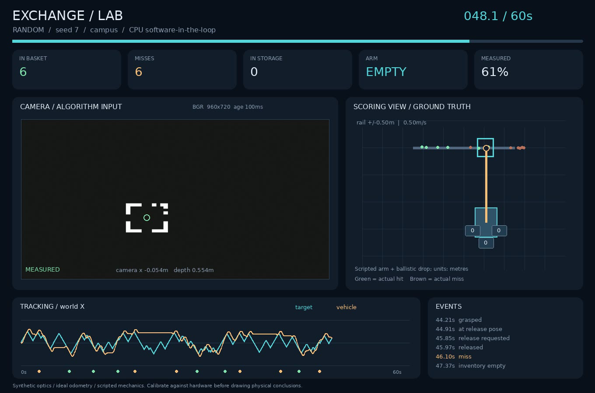

# Codex Free Play

两个独立项目，共用 Git 仓库。项目的代码、配置、测试、说明和本地数据各归其位。

| 项目 | 用途 | 状态 |
| --- | --- | --- |
| [Exchange Sim](projects/exchange-sim/README.md) | 校内赛一分钟视觉自动兑换的 CPU 闭环仿真，支持替换算法、调参和重复评测 | 原生桌面 / 无界面均可运行 |
| [拾页 / Ferry](projects/ferry/README.md) | 网站采集、离线筛选、阅读和导出 | 可运行 |

从根目录启动仿真桌面，或导出一场一分钟的 CPU 仿真录像：

```bash
python3 run.py exchange
python3 run.py exchange --headless --video
```



Python 依赖、真实 C++ 视觉链的构建方式和算法接入见 [Exchange Sim 说明](projects/exchange-sim/README.md)。当前本机已构建的视觉链会自动启用；新 clone 可先用内置基线。

体验 Ferry：

```bash
python3 run.py ferry demo
```

入口会切换到对应项目目录，命令里的相对路径也相对于该项目，避免输出混在仓库根目录。

```text
projects/
  ferry/                   # 独立的爬虫项目
    ferry/                 # Python 源码
    tests/                 # CPU / 本地 HTTP / 终端测试
    scripts/               # 打包工具
    .local/                # 本地演示、采集档案、打包产物（不提交）
  exchange-sim/            # 独立的比赛仿真项目
    exchange_sim/          # 仿真源码
    configs/               # 场景、设备与算法参数
    native/                # 原有 C++ 视觉链的适配器
    tests/                 # CPU 测试
    scripts/               # 构建与评测工具
    .local/                # 私有资料、依赖、构建和运行结果（不提交）
docs/                      # 仓库共用的选题研究与历史
AGENTS.md                  # 后续负责人的工作约束
MEMORY.md                  # 决策、进展和接续记忆
```

根目录只保留导航、共用维护文件和 Git/GitHub 配置。`.git/`、`.github/`、`.gitignore`、`.gitattributes` 应在根目录；运行环境还可能提供只读的 `.agents/`、`.codex/`、`.aws/` 空目录，不属于项目数据。

Ferry 的开发、构建命令见其 README。`make test` 汇总两个项目的 CPU 测试，`make build` 打包 Ferry。两个项目均不需要浏览器或 WebGL。
