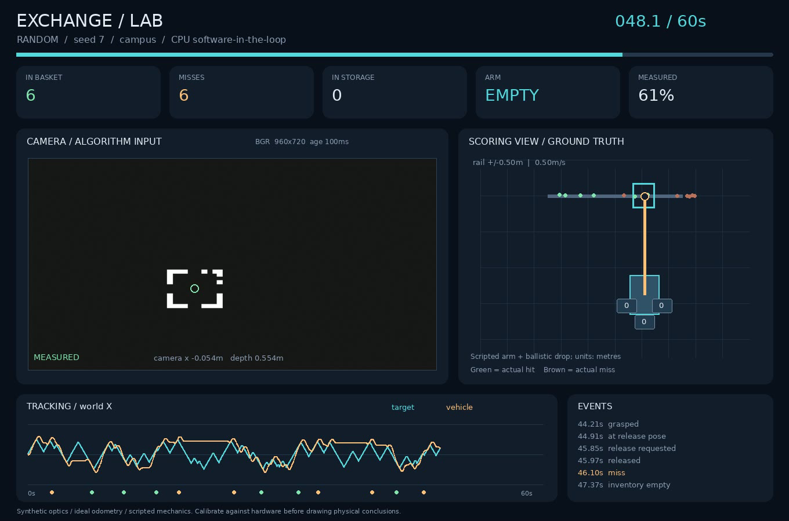

# Exchange Lab

**用同一个一分钟场景，反复验证整条视觉兑换算法。** 原生桌面和无界面两种入口，模拟与绘图均使用 CPU，不需要浏览器、WebGL、ROS 或 GPU。



车周围的存放框已有矿石，机械臂按固定取料/举升路径循环；你的算法读取模拟 BGR 图像和执行端反馈，输出车体速度及释放请求。车辆运动会改变下一帧相机图像，落点由独立真值评分。支持替换感知、状态机、追踪、外环控制和释放策略。

## 运行

仓库根目录：

```bash
python3 run.py exchange
```

打开原生 Tk 窗口，点“开始”。左侧显示相机、机械臂/轨道俯视图、跟随曲线、实际入框和误投事件；右侧可修改完整 JSON 参数。支持暂停/继续、单步、重置、四种运动模式、1–8 倍目标播放速度（受 CPU 限制）和保存结果。比赛结束自动保存，暂停后也能手动保存中间状态。

首次运行缺少依赖时，在 `projects/exchange-sim` 内建立 `.venv`，安装 `requirements.txt`，使用该环境的 Python。桌面还需要系统的 Tk 支持（Linux 包通常为 `python3-tk`）。本机验证环境已经具备这些依赖。无显示连接时使用：

```bash
python3 run.py exchange --headless --video
```

运行完整 60 秒模拟，输出目录为 `projects/exchange-sim/.local/runs/<时间戳>/`。`--video` 生成 15 fps、1360×900 的 MJPEG `demo.avi`；不加此选项可更快评测。播放视频可使用本机播放器。

下文命令均先 `cd projects/exchange-sim`。输出路径相对于该项目，必须位于项目内；已有结果不会被覆盖。

## 接入你的真实视觉链

```bash
python3 scripts/build_campus_bridge.py \
  --source /path/to/campus-marker-opencv-assignment \
  --revision e25d4c98995fff395cf342f20b5fa1ef207a8afb
python3 -m exchange_sim --vision campus
```

构建需要 C++17、CMake、OpenCV ≥4.6、AprilTag ≥3.3 的开发库和 pkg-config。脚本用 `git show` 读取指定提交，提取到本项目 `.local/sources/`，再在 `.local/build/` 编译。**不修改外部仓库，不切换外部分支，也不使用外部工作区的未提交改动。** 换算法提交后可重新指定 `--revision` 构建。

薄适配器逐帧调用原有 `Detector → PoseEstimator → TargetTracker`。配置从快照加载；相机内参、分辨率和畸变参数按当前模拟相机显式覆盖，避免实际标定值和模拟画幅混用。`--campus-config /path/to/config` 可换用自己准备的 YAML 目录，源文件只读。

`--vision auto` 为默认：本地已有桥接构建时用真实链，否则用内置的阈值/包围框/PnP 基线。界面和每次结果都会标明实际使用哪一种；不会悄悄把内置基线称为你的算法。

## 修改场景、重复评测

默认参数在 [configs/exchange.json](configs/exchange.json)，额外 JSON 可以只写覆盖项：

```bash
python3 -m exchange_sim --headless --vision campus --seed 11 --mode random
python3 -m exchange_sim --headless --config configs/stress-delay.json
python3 scripts/compare.py --vision campus \
  --config configs/fast-evaluation.json --seeds 7 11 --modes fixed random
```

`compare.py` 默认比较 A（前馈＋预测释放）和 B（响应式位置控制），可通过 `--policy-a module:factory`、`--policy-b module:factory` 换成自己的两种算法。相同场景使用相同目标轨迹、逐帧随机扰动和按取料次序生成的抓取/落点扰动；算法不同后相机视角可以不同。输出每次运行证据及 `comparison.json` / `comparison.md`，场景哈希用于核对配对条件。

`fast-evaluation.json` 显式关闭逐像素噪声来加速 CPU 对照；`stress-delay.json` 注入观测/释放延迟、周期遮挡与丢包。`--duration` 可缩短实验，正式比较建议覆盖完整一分钟和更多未见种子。

可调参数按 SI 单位组织：

| 参数组 | 内容 |
| --- | --- |
| 时间 | 任务时长、相机/算法周期 `dt_s`、车辆/执行器步长 `physics_dt_s`（默认 1 ms） |
| 兑换框 | 固定、10 秒运动/20 秒静止、匀速往复、随机范围往复；速度、有效行程、净开口、MARK 安装高度 |
| 相机 | 画幅、焦距、5 项畸变、安装高度/平移/三轴角度、亮度、噪声、模糊、整帧 MARK 遮挡/丢失、处理延迟 |
| 车辆 | 初始位置/朝向、最大速度/加速度/角速度、响应时间、轮速里程计与实际位移之间的滑移比例 |
| 机械臂/矿石 | 框位置/库存、取料/举升/回程时间、抓取失败概率、张爪延迟、投放位置/高度、矿石半径、散布 |
| 通信 | 下行延迟、丢包率、速度看门狗 |
| 示例算法 | 增益、前馈、释放预测、安全裕量、稳定帧数、失锁超时 |

`storage_xy_m` 与投放偏移采用车体右/前坐标；世界 X 向右、Y 向前，零航向朝 +Y，正航向从上往下看逆时针。相机为右/下/前。`pitch/yaw/roll` 构成相机坐标到车体对齐相机坐标的 `Rz·Ry·Rx` 旋转，单位 rad。

## 替换整条算法

示例 [examples/image_policy.py](examples/image_policy.py) 从原始 BGR 完成感知到控制，可直接运行：

```bash
python3 -m exchange_sim --headless --vision none \
  --policy examples.image_policy --mode fixed
```

插件提供 `make_policy(settings)`，返回有 `step(SensorPacket) -> Command` 的对象。也可单独用 `--vision module:make_vision` 替换感知模块。接口定义见 [policies.py](exchange_sim/policies.py)。

- 输入：只读延迟图像及其拍摄时间/帧号、可选感知结果、轮速里程计、理想 IMU 航向、机械臂阶段和库存、0x0015 速度反馈字节。
- 输出：`Command(vx, vy, wz, release)`；速度是协议规定的车体系“前、左、逆时针”。已有编码器可直接返回 `Command(speed_frame=完整0x0001帧, release=...)`。
- 插件拿不到目标真值、未来轨迹或种子。俯视图和评分日志属于评测端。此接口是工程隔离，不是针对恶意 Python 的安全沙箱。
- MARK 追踪外推仍标为 `measured=False`，默认释放策略不会把外推当新测量；丢失超过阈值会停车。

速度命令真实经过 v0.3 字节打包、CRC 校验、延迟/丢包和看门狗，再驱动车辆；CRC 错误帧被丢弃并记录。支持速度反馈 0x0015；**尚未仿真整套 UART 流解析、模式/故障/状态/ACK 重传协议。** 机械臂 `READY`、库存、单次释放和释放完成属于明确的仿真 API，因为当前 v0.3 尚未无歧义地定义这些新机构语义。不能把机构许可位当成一次释放，也不能把 ACK 当成功入框。

协议文档算例 `flags=0x16` 与低两位“01 跟踪有效”的文字存在矛盾。本实现按位定义编码有效状态为 `0x15`（跟踪有效＋运动许可＋机构许可），同时验证资料里的 CRC/字节算例；未修改外部协议文档。

## 输出与结果边界

每次保存包括：完整 `config.json`、`summary.json`、`events.json`、逐帧 `frames.csv`、`provenance.json` 和 `snapshot.png`。录像可选。逐帧日志保留实际速度帧十六进制，来源记录包括视觉提交、二进制/配置/仿真源码哈希及插件入口文件哈希。相同依赖和配置下可重跑；日志不是中途恢复全部运行内存的检查点。

评分在矿石预计到达筐口平面的时刻进行，使用当时的真实框位置、净开口和矿石半径。下落继承车辆平移及夹爪偏移带来的旋转切向速度；请求释放不会直接加分。截止时间后仍在飞行的矿石列为 pending，不预先加分。结果按入框数量报告，未实现完整比赛裁判/矿石类型倍率。

当前是**软件在环的场景模型**：车辆平面运动、机械臂固定路径/时序、简化弹道与开口判断。轮速反馈/航向理想化；真实相机纹理、曝光/滚动快门、机械臂自身遮挡、关节 IK/接触/碰撞、弹跳、完整 CAD、Tag/RFID 退出、全场比赛尚未实现。相机延迟在 30 Hz 消费时刻量化，执行器按默认 1 ms 步长推进；CPU 实测耗时不自动充当 MaixCAM 板端时延，板端开销需实测后注入 `camera.latency_s`。

规则可确认的 MARK 80 mm、参考高度、0.5 m/s 及四类运动用于建模；**默认有效行程、净开口、相机安装、矿石尺寸和机构/通信延迟都是可调假设**，不是已测实物。外形尺寸不能等同净开口，1420 mm 底座也不能当有效行程。随机反转采用本项目的固定种子模型、瞬时换向，不宣称复现官方随机运动程序。算法优劣结论限于这些模型，后续需用实拍及实车校准。

## 验证

```bash
python3 -m unittest discover -s tests -v
python3 tests/desktop_smoke.py   # 需要桌面显示连接，原生 Tk，CPU
```

覆盖真实 C++ 视觉链闭环/黑屏、完整一分钟库存与评分、逐帧确定性、原始图像算法替换、丢包/看门狗、CRC/真实协议算例、坏帧、延迟改变落点、截止后飞行和对照报告。没有构建校园赛桥接时，相关一项集成测试明确 skip，其余测试使用内置基线。

本机的配对实验和限制见 [验证记录](docs/VALIDATION.md)。本地资料与生成物统一在 `.local/`，不会发布外部源码、比赛规则原文、图纸或本地依赖。
